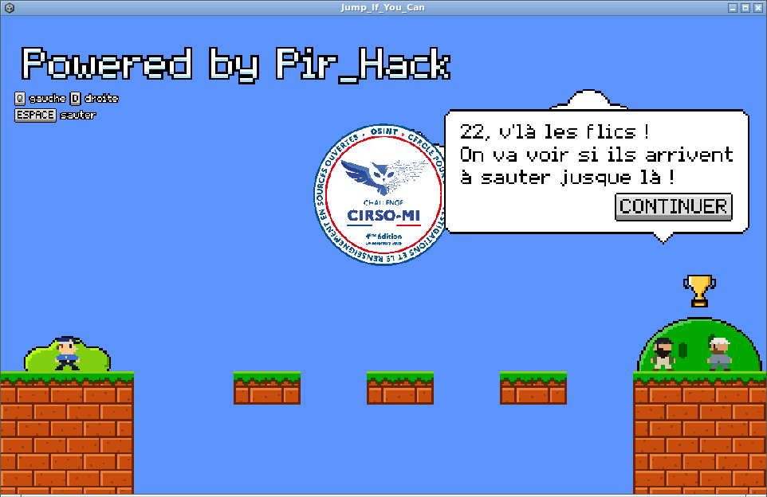

<html>
<head>
  <meta name="description" content="méthode de résolution Jum if you can" />
</head>
</html>

## Challenge CIRSO-MI : Saute si tu peux (Bonus)

**Format de flag:** `CIRSO-MI{3x3mpl3_b0n_d3_fl4g}`

## Resume

Dans ce challenge, il faut faire franchir au petit gendarme un trou impossible à sauter pour qu'il attrape le trophée.
Son objectif : ramener la coupe à la maison !

Le challenge se présente sous forme d'un jeu vidéo 2D (Unity, IL2CPP, Linux).
Il tourne dans un conteneur Docker, avec un bureau accessible depuis le navigateur à l'url suivante
(http://localhost:6080) et **Cheat Engine 7.7.1** pour Linux. 

Pour résoudre de challenge, il faut suivre les étapes suivantes :

1. Ouvrir le processus du jeu dans le logiciel **Cheat Engine**
2. Régler le premier scan (**Float** + **Unknown initial value**)
3. Filtrer les résultats jusqu'à la position X du gendarme (**finding**)
4. Modifier toutes les adresses trouvées pour téléporter le petit gendarme sous le trophée
5. Sauter pour toucher le trophée et récupérer le flag

Bonne chance à tous !

